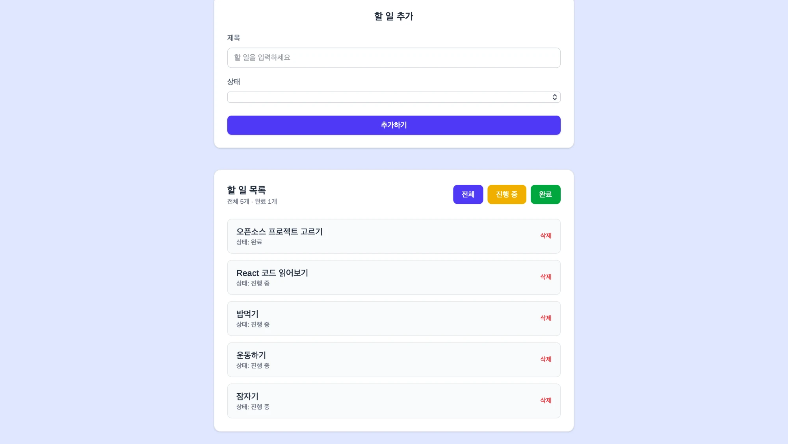

# Assignment 4-2. Open Source Project Exploration & Customizing

## 1. Project Information

프로젝트명: React Todo List

원본 GitHub: https://github.com/qafaraz/React-Todo-List

License: MIT License (Copyright © 2025 Qafar Qəmbərzadə)

### 프로젝트 소개

React Todo List는 React와 Vite를 기반으로 개발된 할 일 관리 웹 애플리케이션이다. 사용자가 해야 할 일을 등록하고 진행 상태에 따라 목록을 관리할 수 있는 프로젝트이다.

주요 기능은 다음과 같다.

1. 할 일 추가: 제목과 진행 상태를 입력하여 새로운 할 일을 등록할 수 있다.
2. 상태별 필터링: 전체, 진행 중, 완료 상태에 따라 할 일 목록을 구분하여 확인할 수 있다.
3. 할 일 삭제: 등록된 할 일 중 불필요한 항목을 삭제할 수 있다.

### 프로젝트 선택 이유

React의 컴포넌트 구조와 상태 관리 방식을 직접 살펴보고 싶어 해당 프로젝트를 선택하였다. Todo List는 기능이 비교적 단순하지만 사용자 입력, 데이터 추가 및 삭제, 조건부 렌더링 등 React의 핵심 개념을 포함하고 있다.

또한 기존 프로젝트의 UI와 기능을 수정하면서 오픈소스 코드를 이해하고 활용하는 경험을 쌓기에 적합하다고 판단하였다.

## 2. Installation

### 설치 및 실행 과정

GitHub에서 원본 프로젝트를 복제한 후 필요한 패키지를 설치하고 개발 서버를 실행하였다.

1. 프로젝트 복제

`git clone https://github.com/qafaraz/React-Todo-List.git`

2. 프로젝트 폴더 이동

`cd React-Todo-List`

3. 의존성 패키지 설치

`npm install`

4. 개발 서버 실행

`npm run dev`

이후 터미널에 표시된 로컬 주소에 접속하여 프로젝트 실행 화면을 확인하였다.

### 실행 화면

[여기에 로컬 실행 화면 캡처 삽입]

## 3. Source Code Exploration

### 3-1. 주요 파일의 역할

① src/main.jsx

React 애플리케이션의 진입점이다. HTML의 `root` 요소에 `App` 컴포넌트를 렌더링하여 웹 애플리케이션을 시작하는 역할을 한다.

② src/App.jsx

애플리케이션의 최상위 컴포넌트이다. `Todo` 컴포넌트와 CSS 파일을 불러와 전체 애플리케이션 화면을 구성한다.

③ package.json

프로젝트에서 사용하는 라이브러리와 실행 명령어를 관리하는 파일이다. React, Vite, Tailwind CSS 등의 의존성과 개발 서버 실행 및 빌드 명령어가 정의되어 있다.

### 3-2. 주요 컴포넌트의 역할

① TodoForm.jsx

사용자가 새로운 할 일을 입력하는 컴포넌트이다. 제목과 진행 상태를 입력받고, `useState`를 활용하여 입력값을 관리한다. 등록 버튼을 누르면 입력된 데이터를 할 일 목록에 추가한다.

② Todolist.jsx

등록된 할 일 목록을 화면에 출력하는 컴포넌트이다. 전체, 진행 중, 완료 상태에 따라 목록을 필터링하고, 각 항목을 삭제하는 기능을 담당한다.

### 3-3. 주요 코드 분석

분석 파일: `src/components/TodoForm.jsx`

분석 코드 (8줄)

```
const change = (e) => {
  setForm({ ...form, [e.target.name]: e.target.value });
}
const submit = (e) => {
  e.preventDefault()
  setTodo((e) => [...e, form]);
  setForm({ task: "", status: "" });
}
```

코드 동작 원리

`change` 함수는 사용자가 입력 필드의 값을 변경할 때 실행된다. 기존 `form` 객체의 데이터를 유지하면서 변경된 입력 필드의 값만 업데이트한다.

`submit` 함수는 할 일 등록 시 실행된다. `preventDefault()`로 기본 폼 제출 동작을 막고, 기존 할 일 배열에 새로운 데이터를 추가한다. 이후 입력값을 초기화하여 다음 할 일을 입력할 수 있도록 한다.

이 코드를 통해 React의 상태 관리와 이벤트 처리 방식을 이해할 수 있었다.

## 4. Customizing

기존 프로젝트를 한국어 사용자가 편리하게 이용할 수 있도록 수정하고, UI 개선과 기능 추가 및 버그 수정을 진행하였다.

### 4-1. Text Customizing

수정 파일: `TodoForm.jsx`, `Todolist.jsx`, `index.html`

기존 프로젝트는 아제르바이잔어로 작성되어 있어 한국어 사용자가 기능을 이해하기 어려웠다. 따라서 입력창, 버튼, 상태 필터 등 화면에 표시되는 문구를 한국어로 변경하였다.

- 변경 전: 아제르바이잔어 문구, `Todo list`
- 변경 후: 한국어 문구, `오늘의 할 일`

### 4-2. Style Customizing

수정 파일: `Todo.jsx`, `TodoForm.jsx`, `Todolist.jsx`

기존의 회색 및 파란색 중심 디자인을 인디고 계열로 변경하여 전체적인 화면 색상을 통일하였다.

- 변경 전: `bg-gray-100`, `bg-blue-600`
- 변경 후: `bg-indigo-100`, `bg-indigo-600`

Tailwind CSS의 유틸리티 클래스를 수정하는 방식으로 배경색과 버튼 색상을 변경하였다.

### 4-3. UI Customizing

수정 파일: `Todolist.jsx`

사용자가 전체 할 일의 수와 완료된 할 일의 수를 한눈에 확인할 수 있도록 개수 표시 기능을 추가하였다.

- 변경 전: 할 일 개수 표시 없음
- 변경 후: `전체 N개 · 완료 M개` 표시

이를 통해 현재 할 일의 진행 상황을 더욱 직관적으로 확인할 수 있도록 개선하였다.

### 4-4. Data Customizing

수정 파일: `Todo.jsx`, `TodoForm.jsx`

첫째, 기존에는 처음 실행했을 때 할 일 목록이 비어 있었으나, 수정 후에는 예시 할 일 2개가 표시되도록 초기 데이터를 추가하였다.

둘째, 기존에는 제목을 최소 5글자 이상 입력해야 등록할 수 있었지만, 짧은 할 일도 등록할 수 있도록 최소 입력 길이를 2글자로 변경하였다.

- 초기 데이터: 빈 배열 → 예시 할 일 2개
- 입력 조건: 최소 5글자 → 최소 2글자

### 4-5. Bug Fix

수정 파일: `Todolist.jsx`

기존 코드에서는 필터링된 목록에서 특정 항목을 삭제할 때 의도하지 않은 다른 항목이 삭제되는 문제가 있었다.

이는 필터링된 배열의 인덱스와 원본 배열의 인덱스가 서로 달라 발생하는 문제였다.

따라서 삭제할 항목을 원본 데이터에서 올바르게 식별하도록 삭제 로직을 수정하였다. 이를 통해 필터 상태에서도 사용자가 선택한 항목만 삭제되도록 개선하였다.

### 4-6. 수정 전후 비교

| 구분 | 수정 전 | 수정 후 |
|---|---|---|
| Text | 외국어 및 영어 | 한국어 |
| Style | 회색·파란색 | 인디고 계열 |
| UI | 할 일 개수 표시 없음 | 전체·완료 개수 표시 |
| Data | 초기 목록 비어 있음 | 예시 데이터 2개 |
| Input | 최소 5글자 | 최소 2글자 |
| Bug | 필터 상태에서 삭제 오류 | 선택한 항목 정상 삭제 |



## 5. Deployment

배포 플랫폼: Vercel

배포 URL: https://react-project22400315.vercel.app

개인 GitHub 저장소: https://github.com/0llll0/Assignment4-2

수정한 React 프로젝트를 Vercel을 이용하여 웹에 배포하였다.

기존 GitHub Classroom 저장소는 비공개 조직 저장소였기 때문에 Vercel 연동을 위해 개인 GitHub 저장소를 생성하였다.

이후 개인 저장소를 Vercel에 연결하고 프로젝트를 배포하여 로컬 환경뿐만 아니라 외부에서도 웹사이트에 접속할 수 있도록 하였다.

[Vercel 배포 화면 캡처 삽입]

## 6. Weekly Review

### 6-1. 새롭게 배운 내용 3가지

① React 컴포넌트 구조

하나의 웹 애플리케이션이 여러 컴포넌트로 나누어 구성되는 방식을 이해하였다. 특히 `TodoForm`과 `Todolist`가 각각 입력과 목록 출력을 담당하며, 컴포넌트 간에 데이터를 전달하는 구조를 살펴볼 수 있었다.

② State와 이벤트 처리

`useState`를 이용하여 데이터를 저장하고, 사용자 입력과 버튼 클릭에 따라 상태를 변경하는 방식을 학습하였다. 상태가 변경되면 화면도 함께 업데이트되는 React의 특징을 이해할 수 있었다.

③ 오픈소스 수정 및 배포 과정

기존 GitHub 프로젝트를 복제한 후 코드를 분석하고, 필요한 기능을 수정하여 배포하는 전체 과정을 경험하였다. 또한 Vercel을 활용하여 React 프로젝트를 실제 웹사이트로 배포하는 방법을 익혔다.

### 6-2. 어려웠던 점과 해결 방법

가장 어려웠던 점은 기존 프로젝트의 데이터 흐름을 이해하고 수정하는 과정이었다.

특히 할 일 목록을 상태별로 필터링한 후 삭제할 때 다른 항목이 삭제되는 문제가 발생하였다. 원인을 분석한 결과 필터링된 배열과 원본 배열의 인덱스가 서로 다르다는 것을 확인하였다.

이후 삭제 로직을 수정하여 올바른 항목이 삭제되도록 해결하였다.

또한 GitHub Classroom의 비공개 조직 저장소를 Vercel에 연결하는 과정에서 어려움이 있었다. 이를 해결하기 위해 개인 GitHub 저장소를 별도로 생성하고 Vercel과 연결하여 배포를 진행하였다.

### 6-3. AI 활용 내용 및 느낀 점

이번 과제에서는 AI를 활용하여 프로젝트 탐색과 코드 수정 과정을 진행하였다.

AI를 활용한 작업

- 과제 조건에 적합한 오픈소스 프로젝트 검색 및 선정
- 기존 소스 코드 분석과 수정
- UI 개선 및 버그 수정
- Git 커밋과 푸시 작업
- 배포된 웹사이트의 동작 확인 지원

직접 수행한 작업

- `npm install`을 통한 패키지 설치 및 빌드 실행
- 개인 GitHub 저장소 생성
- Vercel 프로젝트 연결 및 배포
- README 문서 작성

AI를 활용하면서 기존에 작성된 코드를 빠르게 이해하고 수정 방향을 파악하는 데 도움을 받을 수 있었다.

다만 AI가 제안한 코드도 실제 프로젝트에서 정상적으로 동작하는지 확인하는 과정이 중요하다는 것을 느꼈다. 특히 버그 수정 과정에서는 단순히 코드를 변경하는 것보다 문제의 발생 원인을 이해하는 것이 필요하였다.

이번 과제를 통해 AI를 개발 보조 도구로 활용하는 방법과 함께, 오픈소스 프로젝트의 구조를 분석하고 수정하여 배포하는 전체 개발 과정을 경험할 수 있었다.
